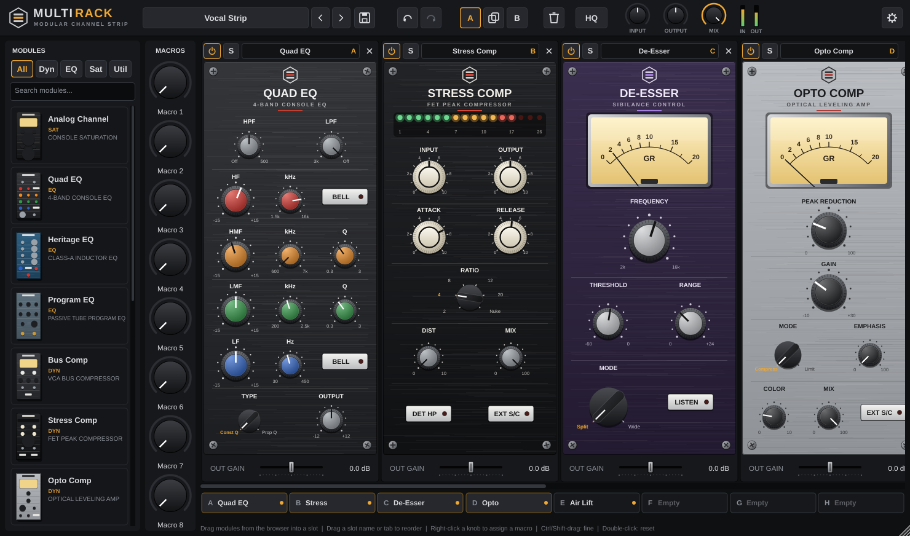

# Multi Rack

Rack modular de channel strip em formato **VST3 para Windows** (testado para uso no **FL Studio**).
Monte sua própria cadeia de processamento com até **8 módulos** em série, arraste para reordenar,
controle vários parâmetros ao mesmo tempo com **8 macros** e compare configurações com **A/B**.



## Recursos

| | |
|---|---|
| **8 slots (A–H)** | Módulos em série, cada um com Power, Solo, Out Gain e menu (trocar, resetar, copiar/colar, mover, remover) |
| **15 módulos** | Dinâmica, EQ, saturação e utilitários (lista abaixo) |
| **Navegador de módulos** | Filtros por categoria (Dyn / EQ / Sat / Util), busca e arrastar-e-soltar |
| **Reordenar** | Arraste o nome do slot ou a aba inferior para outro slot |
| **8 Macros** | Botão direito em qualquer knob → *Assign to macro*. Faixa (início/fim/inverter) configurável. Renomeáveis (duplo clique) |
| **A/B, Undo/Redo** | Comparação A/B e histórico de 64 passos |
| **HQ** | Oversampling 4x (FIR de fase linear) em toda a cadeia, com compensação de latência reportada ao host |
| **Global** | Input, Output e Mix (dry/wet paralelo alinhado em fase) + medidores |
| **Side-chain externo** | Bus de side-chain estéreo para Bus Comp, Stress Comp, Opto Comp e Gate (botão *EXT S/C*) |
| **Presets** | 14 racks de fábrica + presets do usuário (`Documentos\Multi Rack\Presets\*.mrpreset`), importar/exportar |
| **Interface** | Painéis estilo hardware, VU/GR analógicos, redimensionável (60 %–150 %) |
| **Automação** | Todos os parâmetros automatizáveis no FL Studio (nomes `A Param 1`… com valores exibidos em dB/Hz/ms reais) |

### Módulos

| Módulo | Categoria | Descrição |
|---|---|---|
| Analog Channel | Sat | Saturação de console com 6 caracteres (Clean, Iron, Glass, Tube, Punch, Silk), low-cut, tone, VU |
| Quad EQ | EQ | EQ de console 4 bandas, shelves/bell, HPF 18 dB/oct, LPF, Q constante ou proporcional |
| Heritage EQ | EQ | EQ classe A com frequências chaveadas, HPF e estágio de drive com transformador |
| Program EQ | EQ | EQ passivo valvulado (boost + atten na mesma frequência), bandwidth, tube drive |
| Bus Comp | Dyn | Compressor VCA de bus, attack/release chaveados, auto-release, S/C HPF, mix paralelo |
| Stress Comp | Dyn | Compressor FET rápido, ratio *Nuke*, distorção, detector HP, LEDs de GR |
| Opto Comp | Dyn | Leveler óptico dependente do programa, modo Compress/Limit, emphasis, cor valvulada |
| Tape Machine | Sat | Fita: 3 velocidades, head bump, compressão de agudos, saturação, wow & flutter, auto-gain |
| Gate | Dyn | Gate/expansor com hold, histerese e filtros de side-chain |
| De-Esser | Dyn | Split-band ou wide-band, modo Listen |
| Limiter | Dyn | Limiter de pico sem latência, caracteres Clean/Soft/Loud, stereo link |
| Transient Shaper | Dyn | Attack/Sustain independente de nível |
| Air Lift | EQ | Shelf de "ar", excitador harmônico e banda "earth" de graves |
| Trimmer | Util | Ganho, pan, largura estéreo, bass mono, inversão de fase, mono, swap L/R |
| Harmonics | Sat | Saturador multi-modo: Tube, Tape, Transistor, Clip, Fold |

## Instalação no Windows / FL Studio

1. Baixe `MultiRack-Windows-x64.zip` em **Actions → Build → Artifacts** (ou na página **Releases** quando houver uma tag `v*`).
2. Extraia e copie a pasta **`Multi Rack.vst3`** para
   `C:\Program Files\Common Files\VST3\`
3. No FL Studio: **Options → Manage plugins → Find installed plugins** (marque *Verify plugins*).
4. Insira **Multi Rack** em um slot do Mixer.

O plugin é compilado com o runtime do MSVC estático: não precisa instalar o Visual C++ Redistributable.
`Multi Rack.exe` (standalone) também está no zip para testes fora do DAW.

### Side-chain no FL Studio

1. No Mixer, selecione o canal da fonte (ex.: kick), clique com o botão direito na seta da faixa que tem o Multi Rack → **Sidechain to this track**.
2. No wrapper do plugin (ícone de engrenagem) → **Processing**, ajuste o *input port* do side-chain para a fonte.
3. No módulo de dinâmica ligue **EXT S/C**. Sem side-chain conectado, o módulo usa o próprio sinal.

## Dicas

- **Duplo clique** num knob: volta ao padrão. **Ctrl/Shift + arrastar**: ajuste fino.
- **Botão direito** num knob: atribuir a macro, definir faixa da macro, resetar.
- **Botão direito** numa macro: ver/remover atribuições, renomear.
- **Clique no nome do slot**: escolher módulo, copiar/colar, mover, remover.
- **Duplo clique** num módulo do navegador: adiciona no primeiro slot livre.

## Compilar a partir do código

Requisitos: CMake ≥ 3.22 e Visual Studio 2022 (ou mais novo) com *Desktop development with C++*.
O JUCE é baixado automaticamente pelo CMake.

```bash
cmake -S . -B build -A x64
```

```bash
cmake --build build --config Release
```

O plugin fica em `build/MultiRack_artefacts/Release/VST3/Multi Rack.vst3`.

O GitHub Actions (`.github/workflows/build.yml`) compila o VST3 no Windows a cada push, valida com o
[pluginval](https://github.com/Tracktion/pluginval) em strictness 10, roda os testes de DSP/estado/UI no Linux e publica o zip.
Para criar uma release: `git tag v1.0.0 && git push --tags`.

### Testes

```bash
cmake -S . -B build-test -DMR_BUILD_TESTS=ON -DCMAKE_BUILD_TYPE=Release
```

```bash
cmake --build build-test --target MultiRackTest && ./build-test/MultiRackTest_artefacts/Release/MultiRackTest
```

Os testes verificam: transparência do rack vazio (bit-exato), todos os módulos com parâmetros aleatórios
e extremos (normal e HQ), latência do HQ, todos os presets, mover slots, salvar/restaurar estado,
undo/redo, A/B, macros, layout mono e renderizam a interface em PNG.

## Arquitetura

```
Source/
  ModuleDefs.*        definição dos módulos (parâmetros, unidades, layout do painel)
  Dsp.h               biquads, rampas, saturação, gain computer, delay
  Modules.*           processamento de áudio de cada módulo
  PluginProcessor.*   rack, slots, macros, oversampling, estado, undo, A/B
  Presets.*           presets de fábrica e do usuário
  PluginEditor.*      janela principal (barra superior, navegador, rack, abas)
  UI/                 look & feel, knobs, medidores, painéis dos módulos
```

Cada slot tem uma instância pré-alocada de todos os módulos, então trocar de módulo nunca aloca memória
na thread de áudio. Os 16 parâmetros genéricos de cada slot são mapeados para o módulo carregado.

## Aviso

Multi Rack é um projeto independente e original, inspirado no conceito geral de racks modulares de
channel strip. Não contém código, gráficos, marcas ou nomes de produtos de terceiros, e não é afiliado
a nenhum fabricante. Os módulos são designs próprios inspirados em categorias clássicas de equipamentos
de estúdio (compressores VCA/FET/ópticos, EQs de console, fita, etc.).

Feito com [JUCE](https://juce.com) — verifique a licença do JUCE (AGPLv3 ou licença comercial/gratuita
"Starter") antes de distribuir.
